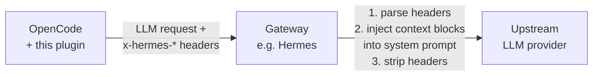

# opencode-hermes

Claude Code-style context reporting for [OpenCode](https://opencode.ai), delivered as `x-hermes-*` HTTP request headers, with narrowly scoped V2 scratchpad guidance synchronization.

On every LLM request the plugin computes Claude Code-style dynamic context blocks (environment, scratchpad directory, git startup snapshot) and sends them as request headers. A gateway (e.g. Hermes) parses the headers, rebuilds the context blocks, and injects them into the request body — so context assembly lives in one place, on the server side. Scratchpad project names intentionally use a readable basename plus a short path hash instead of Claude Code's flattened full path.

[中文说明](README.zh-CN.md) · [Gateway contract (解析与注入规范)](docs/gateway-contract.md)

> **Note:** Full context-block injection remains the gateway's job. V1 only reports headers. V2 also replaces OpenCode's identifiable built-in temporary-directory recommendation for eligible Claude requests with the reported scratchpad path. This request-only synchronization works without a gateway; it does not inject a second context block.

## Quick Start

1. Add the plugin to your `opencode.json` (project or global `~/.config/opencode/opencode.json`):

```json
{
  "plugin": ["@ephemushroom/opencode-hermes"]
}
```

OpenCode installs `plugin` entries automatically with Bun on startup — no manual `npm install` step needed.

2. Restart OpenCode.
3. Send a message with a Claude model — the outgoing request now carries the `x-hermes-*` headers.

### OpenCode 2.0.6

From v0.2.0, both OpenCode generations use the **same package name**. OpenCode 2 uses the native `plugins` configuration (plural):

```jsonc
{
  "$schema": "https://opencode.ai/config.json",
  "plugins": [{
    "package": "@ephemushroom/opencode-hermes",
    "options": { "environment": true }
  }]
}
```

The V2 adapter targets `@opencode/plugin` **2.0.6** and reports context headers plus the request-level scratchpad synchronization described below (verified with OpenCode **2.2.7**). OpenCode's native `execute` and Code Mode `search(...)` own tool execution and discovery; Hermes owns the Claude Code `ToolSearch` compatibility layer. The plugin does not register ToolSearch, maintain tool aliases, or submit synthetic search-result messages. Native `User-Agent` and `x-opencode-*` identity headers are preserved so Hermes can select `NativeBridge`.

Starting with plugin **v0.3.0**, remove the obsolete `toolSearchDelivery` option (old values are ignored). Upgrade Hermes to **v0.4.8 or later** before upgrading the plugin. V1 retains its existing context adapter and requires a host with object-style `server()` support.

The root, `main`, and `/server` exports share a plain `{ id, server, setup }` definition: V1 calls `server`, V2 calls `setup`. [Effect is optional](https://opencode.ai/v2/docs/build/plugins/); this plugin uses the officially supported Promise API and needs no Effect rewrite. Importing the module does not initialize either adapter.

The `/v2` export remains available for programmatic imports. Do not use an npm `/v2` suffix in the current beta's `plugins` configuration: it is interpreted as a local path. Replace any old suffixed entry with the bare name, rather than configuring both. Direct callers of the former default function should use the named `HermesPlugin` export (or `default.server`).

After upgrading, finish active work and run `opencode service restart` before reopening the V2 client. A new request must advertise native `execute` without a plugin ToolSearch.

With options:

```json
{
  "plugin": [["@ephemushroom/opencode-hermes", {
    "environment": true,
    "scratchpad": true,
    "contextManagement": true,
    "gitStatus": true,
    "modelFilter": "claude",
    "gitTimeoutMs": 5000,
    "extraEnvironment": { "team": "platform" }
  }]]
}
```

## What You Get

| Header | Value | Description |
|---|---|---|
| `x-hermes-context-version` | `"1"` | Contract version, bumped on breaking changes |
| `x-hermes-environment` | ASCII-safe JSON | `agent`, `cwd`, `isGitRepo`, `platform`, `shell`, `osVersion` (model info is **not** reported — the gateway reads it from the request body's `model` field) |
| `x-hermes-scratchpad` | ASCII-safe JSON | `{ "path" }` — directory already created on disk (mode `0o700`) |
| `x-hermes-context-management` | `"true"` | Flag only; the block is a static constant owned by the gateway |
| `x-hermes-git-status` | ASCII-safe JSON | `{ branch, mainBranch, user?, status, statusTruncated, recentCommits }` — **omitted entirely outside git repos** |

**ASCII-safe JSON:** every non-ASCII character (e.g. CJK file names in `git status`) is escaped as `\uXXXX`, because HTTP header values are transported as latin-1. `JSON.parse` / `System.Text.Json` restore them natively — no custom decoding.

### Model filtering

By default, headers are sent **only when the model ID contains `claude`** (case-insensitive). Requests to other models (kimi, gpt, …) pass through untouched. Bedrock/OpenRouter-style IDs like `anthropic.claude-*` match as well. Change the substring with `modelFilter`, or set it to `""` to report headers for all models. Filtering uses each request's actual model, including auxiliary requests and mid-session model switches.

V2 prompt synchronization requires **both** a model ID containing `claude` and a `modelFilter` match. A custom filter such as `"sonnet"` narrows the eligible Claude models. A filter such as `"gpt"` or `""` can enable headers on non-Claude models, but never changes their prompts.

## How It Works



- V1 uses `chat.headers`; V2 uses `model.request` for headers and `context`, `compaction`, `generate`, and `title` for scratchpad synchronization. Header and prompt hooks share the same session-cached, created scratchpad path regardless of hook order. Prompt hooks do not run git commands.
- The gateway must **strip all `x-hermes-*` headers** before forwarding — they contain local paths and must never leak upstream raw.
- Parsing, injection templates, and C# examples: [docs/gateway-contract.md](docs/gateway-contract.md).

## Options

| Option | Default | Description |
|---|---|---|
| `environment` | `true` | Send `x-hermes-environment` |
| `scratchpad` | `true` | Create the directory, send `x-hermes-scratchpad`, and synchronize eligible V2 temporary-directory guidance |
| `contextManagement` | `true` | Send `x-hermes-context-management` |
| `gitStatus` | `true` | Send `x-hermes-git-status` |
| `modelFilter` | `"claude"` | Header substring filter; `""` reports for all models. V2 prompt synchronization additionally requires `claude` in the model ID |
| `scratchpadDirName` | Unix: `"claude-<uid>"`; Windows: `"claude"` | Base directory name under the temp root; explicit values are used exactly, with no UID appended |
| `gitTimeoutMs` | `5000` | Per-git-command timeout |
| `extraEnvironment` | — | Extra key/value pairs merged into the environment JSON |

## Environment Variables

| Variable | Effect |
|---|---|
| `HERMES_CONTEXT_DISABLE=1` (or `true`) | Disable the plugin entirely: no headers or prompt synchronization |
| `CLAUDE_CODE_TMPDIR` | Scratchpad temp root (same semantics as Claude Code) |

### Scratchpad Paths

The layout is `<root>/<base>/<project-name>-<hash>/<full-sessionID>/scratchpad`:

- The default root is `/tmp` on macOS (resolved to `/private/tmp`), and `os.tmpdir()` on Linux and Windows. A nonempty `CLAUDE_CODE_TMPDIR` overrides it.
- The default base is `claude-<uid>` on Unix and `claude` on Windows. Omit `scratchpadDirName` to keep this platform-aware default; an explicit `"claude"` disables the Unix UID suffix.
- The project segment preserves Unicode (for example, `笔记Note-<8 hex digits>`). Its suffix is the first eight lowercase SHA-256 hex digits of the normalized absolute working-directory path, distinguishing same-named projects in different locations. This is lexical normalization, not symlink resolution.
- Filesystem-invalid characters are replaced with `-`, trailing dots/spaces removed, and an empty/root basename becomes `root`. The readable name is capped at 200 UTF-8 bytes without splitting Unicode code points; the entire segment is at most 209 bytes.
- The full session ID is retained. Directories are created with mode `0o700` (subject to platform support). Header JSON remains ASCII-safe and restores the Unicode path on parsing.

This intentionally differs from Claude Code's project slug. Existing scratchpads are not migrated or deleted, and session caching and OpenCode access permissions are unchanged.

### V2 Temporary-Directory Guidance

For eligible requests, V2 replaces only the built-in `Prefer ... over generic system temporary directories such as /tmp; it is pre-created and approved for external access.` line inside `core/environment`. The new line is `Prefer <scratchpad path> for temporary work files instead of generic system temporary directories.` It uses the actual existing path from `x-hermes-scratchpad`, without claiming that OpenCode has preapproved access to it.

The replacement requires valid `metadata.experimental.instructions` provenance, exactly one identifiable core environment, and a unique visible match. The instruction-bearing part must still exactly equal its metadata source texts joined with blank lines. Missing/malformed metadata, duplicate candidates, edits by an earlier plugin, or an unknown template cause a conservative no-op. There is **no text-only fallback** and no competing instruction is appended. Older hosts without this experimental metadata still receive headers, but keep their original recommendation.

Only outgoing system text is changed. Metadata, unrelated environment lines, custom/quoted copies, user messages, stored history, native identity, and tools remain untouched. Auxiliary hooks apply the same rules and do nothing when their request has no matching environment. `scratchpad: false`, the kill switch, model filtering, or directory creation failure prevents synchronization. The plugin does not change `Global.tmp`, `TMPDIR`, OpenCode's own temporary files, or permission rules; accessing the scratchpad may still require approval.

## Development

```bash
bun install
bun test            # bun's built-in runner, includes a live git-repo smoke test
bun run typecheck   # tsc --noEmit (strict)
bun run build       # bundle dist/index.js + emit declarations
bun run lint        # oxlint
```

Optional isolated end-to-end capture (requires an installed OpenCode 2.2.7 binary):

```bash
bun run build
QA_OPENCODE_BIN=/path/to/opencode node test/v2-live-capture.mjs /path/to/approved/temp/root
```

This starts private `run --standalone` servers and a localhost mock provider, with separate home/config/data/database directories and dummy credentials. It checks final Claude, non-Claude, and disabled requests plus native tool continuations, writes sanitized captures/results under the given root, and removes its runtime directories and processes. It never connects to a real model provider or the existing desktop service.

The plugin executes using Node/Bun built-ins and Zod. Both OpenCode SDK imports are type-only (erased at build time); their packages remain dependencies so published TypeScript declarations can resolve them. No SDK or Effect code is imported at runtime.

## License

MIT
